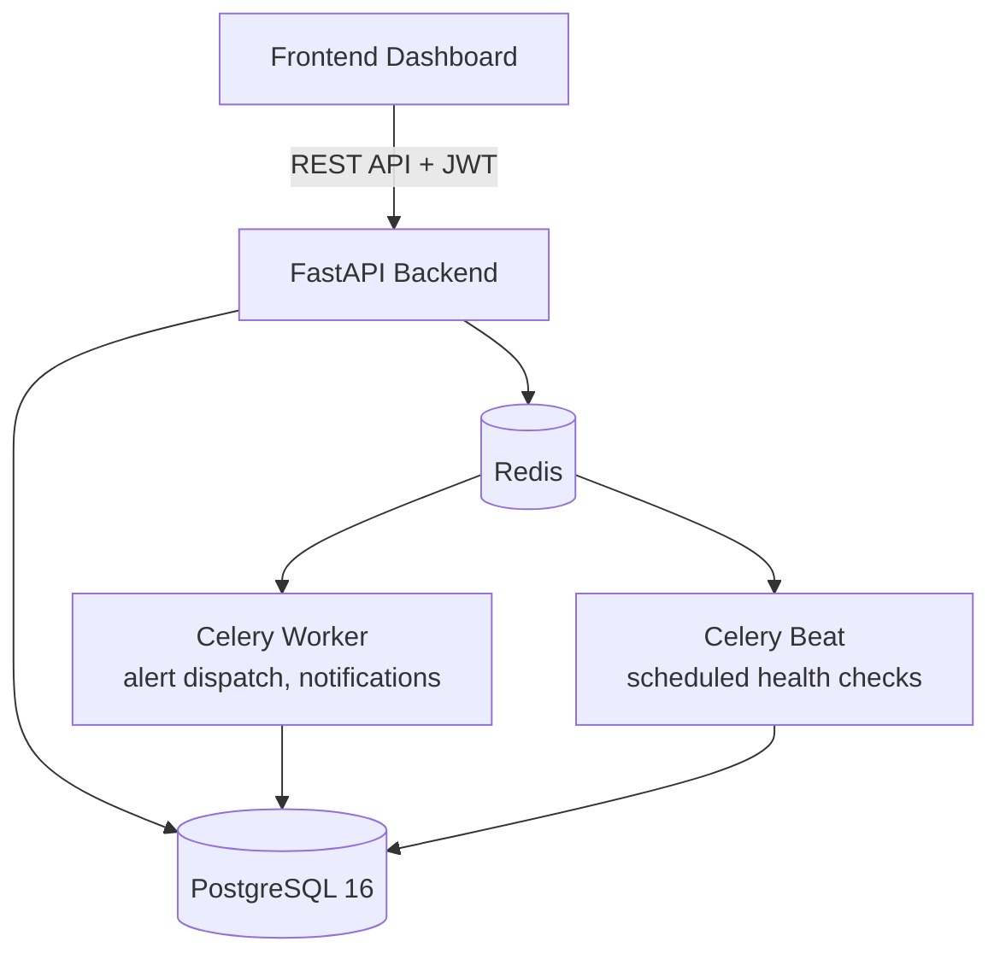

<div align="center">

# ⚡ PulseOps

### IT & DevOps Monitoring and Incident Management Platform

A containerized backend system for real-time service monitoring, alerting, and incident tracking — built with **FastAPI**, **Celery**, **Redis**, and **PostgreSQL**.

[](https://fastapi.tiangolo.com/)
[](https://www.python.org/)
[](https://www.postgresql.org/)
[](https://redis.io/)
[](https://docs.celeryq.dev/)
[](https://www.docker.com/)
[](https://jwt.io/)

</div>

---

## 📌 About

**PulseOps** monitors service health, raises incidents when something breaks, and processes alerts asynchronously — without blocking the API. It's built as five independently containerized services (API, database, cache/broker, worker, scheduler), the same pattern used in real production monitoring platforms.

---

## ✨ Features

- 🔐 **JWT Authentication** — access + refresh token flow for secure, stateless sessions
- 📡 **Scheduled Health Monitoring** — periodic checks run automatically via Celery Beat
- 🚨 **Incident & Alert Pipeline** — issues detected by monitoring flow into trackable incidents
- 🔔 **In-App Notifications** — real-time alerts surfaced directly in the dashboard
- 📧 **Email Notifications** — powered by [Resend](https://resend.com/), dispatched asynchronously via Celery
- ⚙️ **Async Task Processing** — notifications and alert dispatch run on Celery workers, off the request cycle
- 🗃️ **Persistent Storage** — PostgreSQL for users, services, and incident history
- ⚡ **Redis-Backed** — used as both the Celery broker and application cache
- 🐳 **One-Command Setup** — entire stack boots with a single `docker-compose up`
- 🧪 **Static Type Checking** — enforced with [Pyrefly](https://pyrefly.org/)

---

## 🏗️ Architecture



All five services (`backend`, `db`, `redis`, `worker`, `beat`) run in their own containers, defined in `docker-compose.yml`.

---

## 🛠️ Tech Stack

| Layer | Technology |
|---|---|
| API Framework | FastAPI (Python) |
| Auth | JWT — Access & Refresh Tokens |
| Database | PostgreSQL 16 |
| Cache / Broker | Redis 7 |
| Async Tasks | Celery Worker |
| Scheduling | Celery Beat |
| Email | Resend |
| Frontend | JavaScript/TypeScript (`frontend/`) |
| Containerization | Docker & Docker Compose |
| Type Checking | Pyrefly |

---

## 📁 Project Structure

```
PulseOps/
├── backend/            # FastAPI app — auth, monitoring, incidents, Celery tasks
├── frontend/            # Client dashboard
├── docs/                 # Documentation
├── docker-compose.yml     # Orchestrates API, DB, Redis, worker, beat
├── pyproject.toml         # Pyrefly type-checking config
└── .gitignore
```

---

## 🚀 Getting Started

**Prerequisites:** [Docker](https://www.docker.com/), [Docker Compose](https://docs.docker.com/compose/), Git

**1. Clone**
```bash
git clone https://github.com/Harsh-Kumar-Pandit/PluseOps.git
cd PluseOps
```

**2. Set environment variables** — create `backend/.env`:
```env
DATABASE_URL=postgresql://postgres:1234@db:5432/pulseops
REDIS_URL=redis://redis:6379/0
JWT_SECRET_KEY=your-secret-key
JWT_ACCESS_TOKEN_EXPIRE_MINUTES=15
JWT_REFRESH_TOKEN_EXPIRE_DAYS=7
RESEND_API_KEY=your-resend-api-key
```

**3. Run the stack**
```bash
docker-compose up --build
```

| Service | Role | Port |
|---|---|---|
| backend | FastAPI REST API | 8000 |
| db | PostgreSQL 16 | 5432 |
| redis | Broker + cache | 6379 |
| worker | Celery worker | — |
| beat | Celery scheduler | — |

API runs at `http://localhost:8000`.

**4. Run the frontend**
```bash
cd frontend
npm install
npm start
```

---

## 🔑 Auth Flow

1. User logs in → gets a short-lived **access token** + longer-lived **refresh token**
2. Access token authorizes API requests
3. Refresh token issues a new access token on expiry, without re-login

---

## 🗺️ Roadmap

- [ ] Incident timeline & post-mortem reports
- [ ] Role-based access control (RBAC)
- [ ] CI/CD pipeline + automated tests

---

## 👤 Author

**Harsh Kumar Pandit**
[GitHub](https://github.com/Harsh-Kumar-Pandit)
